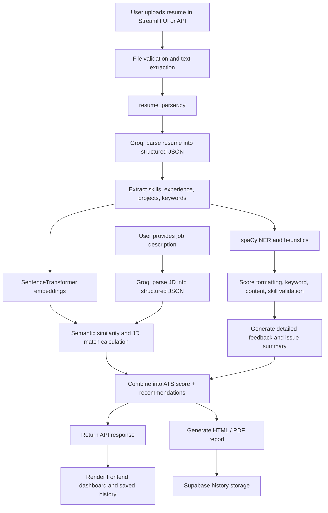

# ATS Resume Scorer

ATS Resume Scorer is a full-stack resume analysis application that ingests a resume, extracts structured information, compares it with a job description, and produces an ATS-focused score with issue summaries, skill validation, and recommendation feedback.

This repository combines:
- a FastAPI backend for file parsing, resume analysis, scoring, and PDF generation,
- a Streamlit frontend for authentication and user interactions,
- optional Supabase-backed history storage,
- spaCy and SentenceTransformer-based NLP/semantic matching,
- a Groq LLM-based resume and job description parser.

## Project summary

The codebase is not a single end-to-end ML training pipeline in production. Instead, it is a practical ATS screening app built around heuristics plus semantic similarity:

1. A resume PDF/DOCX is uploaded.
2. The backend extracts text from the file.
3. A Groq LLM parses resume/job data into JSON fields such as skills, experience, projects, and keywords.
4. spaCy analyzes named entities and text structure.
5. A SentenceTransformer model creates semantic embeddings for resume text and job description text.
6. Keyword overlap, fuzzy matching, semantic similarity, and heuristics are combined into an ATS score.
7. The result is returned to the frontend and optionally saved to Supabase and exported as a PDF.

## Repository structure

```text
ATS_SCORER/
├── backend/
│   ├── api/
│   │   ├── auth.py
│   │   └── routes.py
│   ├── core/
│   │   └── config.py
│   ├── database/
│   │   └── supabase_db.py
│   ├── main.py
│   ├── models/
│   │   └── schemas.py
│   ├── services/
│   │   ├── ats_scorer.py
│   │   ├── feedback_engine.py
│   │   ├── groq_parser.py
│   │   ├── jd_matcher.py
│   │   ├── pdf_export.py
│   │   ├── recommendation_engine.py
│   │   ├── report_generator.py
│   │   ├── resume_analyzer.py
│   │   └── resume_parser.py
│   ├── templates/
│   │   ├── action_items.html
│   │   ├── jd_comparison.html
│   │   ├── quick_actions.html
│   │   └── summary.html
│   └── utils/
│       ├── file_utils.py
│       └── matching.py
├── frontend/
│   ├── assets/
│   │   └── styles.css
│   ├── components/
│   ├── services/
│   ├── views/
│   ├── streamlit_app.py
│   └── __init__.py
├── jupyter notebooks/
│   ├── 01_EDA_and_DATA_prep.ipynb
│   ├── 02_BERT_EMBEDDINGS.ipynb
│   └── 03_BERT_FINETUNEipynb.ipynb
├── tests/
│   ├── test_groq_parser.py
│   ├── test_pdf_export.py
│   └── test_resume_parser.py
├── requirements.txt
├── .env
├── README.MD
└── ...
```

## Architecture and runtime flow

The project has two main interfaces:

- Streamlit app for human users and authentication
- FastAPI API for analysis and PDF generation

### API startup

The FastAPI app is created in `backend/main.py`.

On startup, it loads:
- `en_core_web_md` via spaCy as the primary NLP model,
- fallback to `en_core_web_sm` if the primary model is missing,
- a SentenceTransformer encoder configured by `SENTENCE_TRANSFORMER_MODEL` (default: `all-MiniLM-L6-v2`).

The app is mounted at `/api/v1` and includes routes such as:
- `POST /api/v1/analyze-resume`
- `GET /api/v1/history`
- `DELETE /api/v1/history/{analysis_id}`
- `GET /api/v1/health`
- `POST /api/v1/generate-pdf`

### Frontend runtime

The Streamlit app in `frontend/streamlit_app.py` manages:
- sign-in and sign-up via Supabase,
- Google OAuth flow,
- navigation across landing, scorer, history, and resources views.

The frontend does not do the heavy scoring itself; it calls the backend API using `frontend/services/api_client.py` and stores history with Supabase.

## End-to-end workflow

### 1. Resume upload and validation

`backend/api/routes.py` handles the upload route `POST /api/v1/analyze-resume`.

The uploaded resume file is read and passed to `parse_resume_file()` in `backend/services/resume_parser.py`.

That parser:
- checks file size,
- detects whether the file is PDF/DOCX,
- extracts text from the document,
- supports PDF fallback using both `pdfplumber` and `PyPDF2`,
- rejects unsupported or empty files.

`resume_parser.py` extracts text from:
- PDF files using `pdfplumber` first, then `PyPDF2` fallback,
- DOCX files using `python-docx`,
- and intentionally rejects legacy `.doc` files.

### 2. Structured parsing of the resume

Once the document text is extracted, the backend calls `analyze_full_resume()` in `backend/services/resume_analyzer.py`.

This function starts by running `parse_resume()` from `backend/services/groq_parser.py`.

`parse_resume()` calls the Groq chat completion API with a JSON extraction schema and asks for fields such as:
- name, email, phone, LinkedIn, GitHub,
- professional summary,
- skills,
- experience entries,
- education,
- certifications,
- projects,
- action verbs,
- keywords.

The response is validated so all expected keys exist even when the LLM response is incomplete or malformed.

### 3. Job description parsing

If the user provides a job description, `analyze_full_resume()` calls `parse_job_description()` from the same Groq parser.

This extracts:
- job title,
- required skills,
- preferred skills,
- experience requirements,
- education requirements,
- responsibilities,
- keyword list for ATS matching.

This is important because the scoring pipeline uses both the resume and the job description for semantic and keyword comparison.

### 4. NLP preprocessing and analysis

The code uses spaCy for language-level features:
- named entity recognition,
- noun chunks,
- job-description skill gap extraction,
- location/privacy detection,
- simple heuristics for formatting and candidate quality.

Relevant logic appears in:
- `backend/services/ats_scorer.py`
- `backend/services/jd_matcher.py`
- `backend/services/feedback_engine.py`

The NLP layer helps answer questions like:
- which geographies or addresses appear,
- which keywords or entities are present,
- which skills are missing from the resume relative to the JD,
- which resume sections are weak or absent.

### 5. Sentence-transformer semantic similarity

The runtime app loads a `SentenceTransformer` encoder and stores it in `app.state.embedder` during FastAPI startup.

The code then uses it for:
- semantic similarity between resume text and job description text,
- validation of a skill by comparing it against project and experience text,
- tracking how strongly a skill matches the user’s written evidence.

The similarity method is a standard cosine dot-product calculation:

```python
similarity = np.dot(resume_emb, jd_emb) / (
    np.linalg.norm(resume_emb) * np.linalg.norm(jd_emb)
)
```

This is implemented in `backend/services/jd_matcher.py` and `backend/services/ats_scorer.py`.

### 6. Skill validation and project evidence

`validate_skills_with_projects()` in `backend/services/ats_scorer.py` checks each extracted skill against:
- project descriptions,
- experience section text,
- semantic similarity thresholds.

This creates structured output such as:
- validated skills,
- unvalidated skills,
- project mapping for each skill,
- validation percentage.

This is later exposed as `skill_validation_details` in the API JSON response.

### 7. Score composition

`calculate_overall_score()` in `backend/services/ats_scorer.py` combines multiple scoring components:
- formatting score,
- keyword score,
- content score,
- skill validation score,
- ATS compatibility score.

The config file `backend/core/config.py` sets these weights:

```python
SCORE_WEIGHTS = {
    "formatting": 20,
    "keywords": 25,
    "content": 25,
    "skill_validation": 15,
    "ats_compatibility": 15,
}
```

The score is then converted into a final comprehensive ATS score and interpretation string.

### 8. Feedback generation

`backend/services/feedback_engine.py` produces a list of structured `IssueDetail` entries based on:
- missing project section,
- missing experience or education sections,
- sparse skill detection,
- weak action verbs or achievement language,
- skill validation results,
- privacy/location issues.

This module produces:
- `issues_summary`
- `detailed_feedback`
- `strengths`
- `interpretation`

### 9. JD comparison and scoring

`backend/services/jd_matcher.py` computes:
- match percentage,
- semantic similarity,
- matched keywords,
- missing keywords,
- skills gap.

The actual quality is a blended formula:

```python
match_pct = (keyword_overlap * 0.6 + semantic_similarity * 0.4) * 100
```

So the system combines fuzzy keyword overlap with embedding-based semantic understanding.

### 10. Output generation

The final API response is an `AnalysisResponse` object defined in `backend/models/schemas.py`.

It includes:
- ATS score,
- component scores,
- issue summary,
- detailed feedback,
- JD match analysis,
- skill validation details,
- keyword match and missing keywords.

The same result can be turned into HTML and then PDF using:
- `backend/services/report_generator.py`
- `backend/services/pdf_export.py`

The HTML templates live under `backend/templates/` and render summary, skill, and JD comparison reports.

### 11. Persistence and history

If Supabase credentials are configured, `backend/database/supabase_db.py` stores analyzed resumes in an `analyses` table and can fetch or delete user history.

This is not required for local analysis but supports user history in the product UI.

## Model inventory and what is actually used

The project uses more than one model family, but not all are deployed in the running app.

### 1. spaCy NLP model

Evidence in code:
- `backend/main.py`
- `backend/core/config.py`

Configured as:
- primary: `en_core_web_md`
- secondary: `en_core_web_sm`

Purpose:
- extract entities,
- analyze noun chunks,
- detect locations,
- support ATS heuristics.

This is a standard production NLP dependency, not a custom-trained model.

### 2. Groq-hosted LLM

Evidence:
- `backend/services/groq_parser.py`
- `backend/core/config.py`

Configured by environment variable:
- `GROQ_API_KEY`
- `GROQ_MODEL` (default: `openai/gpt-oss-120b`)

Purpose:
- parse resume text into JSON,
- parse job descriptions into JSON,
- extract structured data from unformatted text.

Important note: this is not a local model being trained or loaded in the repo. It is a remote inference service via the Groq API.

### 3. SentenceTransformer model in the app

Evidence:
- `backend/main.py`
- `backend/services/jd_matcher.py`
- `backend/services/ats_scorer.py`

Runtime model:
- `SentenceTransformer(SENTENCE_TRANSFORMER_MODEL)`
- default `all-MiniLM-L6-v2`

Purpose:
- generate sentence embeddings for resume/JD semantic comparison,
- validate skill relevance based on semantic overlap,
- support JD matching and skill evidence scoring.

This is the main embedding model used by the production app.

### 4. Notebook BERT/embedding exploration: `all-mpnet-base-v2`

Evidence:
- `jupyter notebooks/02_BERT_EMBEDDINGS.ipynb`
- `jupyter notebooks/03_BERT_FINETUNEipynb.ipynb`

The notebooks explicitly load:
- `SentenceTransformer('all-mpnet-base-v2')`

Purpose:
- evaluate how resume/JD semantic similarity compares to a hand-coded or heuristic match score,
- build similarity examples for analysis,
- demonstrate fine-tuning behavior for resume-to-job matching.

This is an experimental model setup for research and notebook analysis, not the production app’s active model.

### 5. Fine-tuning experiment (not wired into the application)

The notebook `03_BERT_FINETUNEipynb.ipynb` shows a real training recipe using sentence-transformers:

- base model: `SentenceTransformer('all-mpnet-base-v2')`
- loss function: `losses.CosineSimilarityLoss(model)`
- dataloader: `DataLoader(train_examples, shuffle=True, batch_size=16)`
- evaluator: `EmbeddingSimilarityEvaluator.from_input_examples(val_examples, name='ats-val')`
- train pairs: 186
- steps per epoch: 12
- save location: `models/finetuned-bert`

This confirms that the project explored fine-tuning a Sentence-BERT-style model to predict resume-to-job similarity. That experiment is documented in notebooks, but the live backend code does not load this fine-tuned artifact at runtime.

## BERT embeddings in detail

### What is actually used?

The production app does not directly import Hugging Face `transformers.AutoTokenizer`, `AutoModel`, or `BertModel` classes. Instead, it relies on the `sentence-transformers` library, which wraps the underlying Transformer infrastructure.

In other words:
- the app uses `SentenceTransformer`
- the underlying model is a sentence embedding model,
- it is not a raw BERT classification head or a custom Hugging Face training loop in production code

### Embedding generation flow

The runtime code does the following:

```python
from sentence_transformers import SentenceTransformer
embedder = SentenceTransformer(SENTENCE_TRANSFORMER_MODEL)
resume_emb = embedder.encode(resume_text[:5000], convert_to_tensor=False)
jd_emb = embedder.encode(jd_text[:5000], convert_to_tensor=False)
```

This is exactly the sequence used in `backend/services/jd_matcher.py`.

The similarity is computed using cosine similarity, not a learned classification head.

### Embedding characteristics

The project does not explicitly log or hard-code an embedding dimension in the backend code.

However, for the default `all-MiniLM-L6-v2` model, the SentenceTransformer checkpoint typically produces a 384-dimensional embedding. The app never checks or serializes the dimension explicitly, so that dimension is inferred from the model checkpoint rather than exposed by the app itself.

### Pooling and sentence embeddings

This is an important distinction:

- A raw BERT model produces token-level hidden states and a pooled representation.
- A sentence-transformers model fine-tunes a sentence embedding architecture to create semantic vectors optimized for similarity search and clustering.
- The app’s pipeline uses sentence embeddings, not raw `[CLS]` token extraction.

This is consistent with the code’s use of `SentenceTransformer.encode()`, which returns a sentence-level embedding vector.

### Comparison strategy

The app compares two vectors using cosine similarity:

```python
similarity = np.dot(A, B) / (||A|| * ||B||)
```

This produces a value in the range roughly `[0,1]` after clipping.

That is the metric used to compare:
- resume vs job description,
- skill vs project text,
- skill vs experience text.

### Notably absent

The repository does not show a production `Trainer`, `TrainingArguments`, `BertForSequenceClassification`, or custom fine-tuning loop in the deployed app. The only explicit training/evaluation experiment is in the notebook files.

## Fine-tuning investigation

The project contains exploratory BERT fine-tuning notebooks, but the production backend is not configured to load or use a fine-tuned model.

### Notebook evidence

The notebook `03_BERT_FINETUNEipynb.ipynb` contains a training setup with:
- `SentenceTransformer('all-mpnet-base-v2')`
- `DataLoader(train_examples, shuffle=True, batch_size=16)`
- `losses.CosineSimilarityLoss(model)`
- `EmbeddingSimilarityEvaluator`
- 186 training examples
- validation-based evaluation
- saved output path: `models/finetuned-bert`

This is a legitimate semantic similarity fine-tuning experiment.

### What is not true for the app

The running API at `backend/main.py` does not load a local fine-tuned checkpoint such as `models/finetuned-bert`.

Instead, it loads the pretrained default model:

```python
app.state.embedder = SentenceTransformer(SENTENCE_TRANSFORMER_MODEL)
```

So the app is using a pretrained sentence embedding model for inference only, not a model trained in the deployment pipeline.

## Dependency analysis

The project includes several libraries, but not all are equally central.

### Core Python / API

- `fastapi` — backend API framework
- `uvicorn` — ASGI server for running FastAPI
- `pydantic` — response and request validation schemas
- `python-multipart` — file upload form support
- `python-dotenv` — reads `.env` configuration
- `PyJWT[crypto]` — verifies JWT access tokens from Supabase

### NLP / ML

- `spacy` — entity extraction, noun chunks, text heuristics
- `sentence-transformers` — embedding generation for semantic similarity
- `numpy` — vector math and similarity calculations
- `rapidfuzz` — fuzzy keyword matching and normalized comparison

### File parsing

- `pdfplumber` — PDF text extraction
- `PyPDF2` — fallback PDF extraction
- `python-docx` — DOCX parsing

### Reporting and export

- `jinja2` — HTML template rendering
- `reportlab` — PDF generation wrapper used by the export pipeline

### External services and auth

- `groq` — remote LLM API used for structured resume/JD parsing
- `httpx` — async HTTP client for Supabase calls
- `supabase` — frontend auth and database access
- `requests` — frontend HTTP calls

### Frontend

- `streamlit` — user interface and auth flows

## Project workflow diagram



## Setup and execution

### Install dependencies

```bash
pip install -r requirements.txt
python -m spacy download en_core_web_md
```

### Run the backend

```bash
uvicorn backend.main:app --reload --host 0.0.0.0 --port 8000
```

### Run the frontend

```bash
streamlit run frontend/streamlit_app.py
```

### Environment variables

The app expects a `.env` file with values such as:

```env
GROQ_API_KEY=...
SUPABASE_URL=...
SUPABASE_KEY=...
SUPABASE_ANON_KEY=...
SUPABASE_JWT_SECRET=...
SENTENCE_TRANSFORMER_MODEL=all-MiniLM-L6-v2
GROQ_MODEL=openai/gpt-oss-120b
```

## What this project does well

- Parses PDF and DOCX resumes reliably
- Extracts structured metadata from resumes with an LLM
- Compares resume text to a job description semantically
- Produces ATS-oriented scoring and recommendations
- Provides issue-based guidance for resume quality
- Exports summary reports to PDF
- Stores history for authenticated users

## What is experimental versus production

This project clearly demonstrates a hybrid system:

- production runtime: heuristics + spaCy + SentenceTransformer + Groq + FastAPI/Streamlit
- experimental notebook work: BERT / sentence-transformer fine-tuning using `all-mpnet-base-v2`

The notebook training work is valuable for research and experimentation, but it is not the exact model the running application currently loads in `backend/main.py`.

## Bottom line

The real implementation in the repository is an ATS resume analyzer that combines:
- document parsing,
- LLM-based extraction,
- spaCy-based NLP heuristics,
- sentence-transformer semantic similarity,
- fuzzy matching and weighted ATS scoring,
- frontend + backend + optional Supabase persistence.

The repository therefore represents a practical educational and product-oriented ATS scoring system rather than a single pure deep-learning model pipeline.
